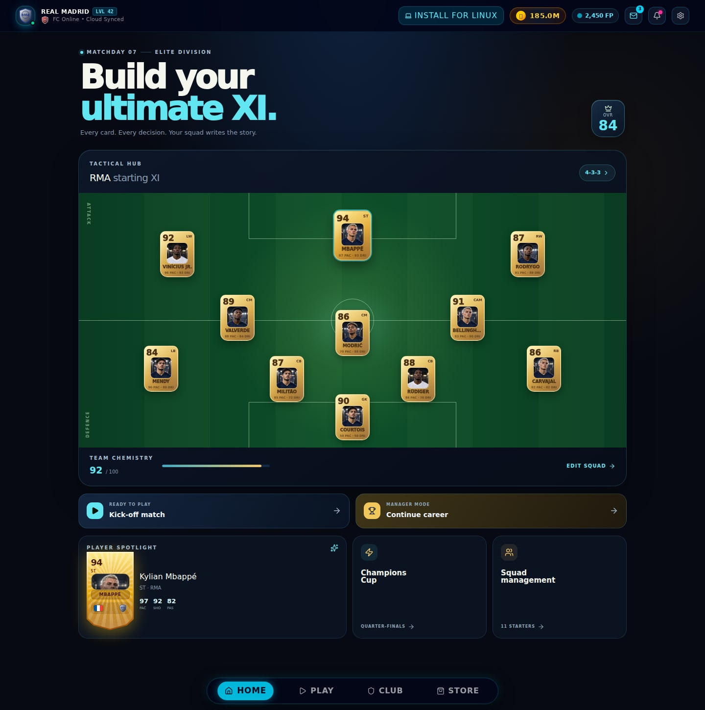

# FC 2026 Soccer

FC 2026 is a football game project moving toward a mobile 3D experience in **Unity 6 and C#**. The repository also contains a playable React/TypeScript browser prototype and an experimental Flutter client. The Unity work is still split across two projects, so features and setup steps below identify which implementation they describe.

<p align="center"><strong>BUILD YOUR CLUB · OWN THE MATCH · CHASE THE TROPHY</strong></p>

## Current project status

| Implementation | Current role | Location |
| --- | --- | --- |
| Unity 3D prototype | 3D pitch, player movement, ball physics, match camera and Android build path | [`unity/FC2026Unity`](unity/FC2026Unity) |
| Unity Football World prototype | Career and squad systems, Football World data, transfer screens, UI theme and Unity multiplayer services | [`unity_app`](unity_app) |
| Browser game | React/TypeScript 2D match prototype and management UI | [`src`](src) |
| Flutter experiment | Separate early mobile UI experiment | [`flutter_app`](flutter_app) |

**The two Unity folders are separate projects with different Unity editor versions.** The 3D prototype uses Unity `6000.3.24f1`; the Football World project uses `6000.0.1f1`. Consolidating them into one supported Unity project is the next architecture step. See [`UNITY_3D.md`](UNITY_3D.md) for the 3D prototype and [`unity_app/README.md`](unity_app/README.md) for the Football World project.

## Screens

The current React home screen has a cinematic night stadium backdrop, featured player portrait, match and career entry points, mode cards, and a club squad panel. The attached reference screenshots informed the visual direction; they are not bundled in this repository.

The repository’s existing screenshots show an earlier React interface and are retained as historical web prototype references:

| Previous squad hub | Previous match setup |
| --- | --- |
|  |  |

## Gameplay prototypes

### React/TypeScript browser game

- Offline 2D matches with ball movement, shooting, passing, sprinting and tackling
- Kick-off, career, tournament, penalty and practice screens
- Squad management, player editor, generated face cards and local career saves
- Responsive touch controls and PWA install support

Run it from the repository root:

```bash
npm install
npm run dev
```

Vite serves the browser prototype at `http://localhost:3000`.

```bash
npm run lint
npm run build
```

### Unity 3D prototype

The 3D match foundation is documented in [`UNITY_3D.md`](UNITY_3D.md). It uses procedural humanoid players, Rigidbody ball physics, positional AI, goal detection, match scoring, broadcast camera and touch controls. The current implementation is a prototype; advanced animation, complete career migration, mobile rendering optimization, and release signing remain development work.

Open `unity/FC2026Unity` with Unity `6000.3.24f1`. Android builds require Android Build Support, Android SDK & NDK Tools, and OpenJDK. The Unity Editor build menu and command-line instructions are in [`UNITY_3D.md`](UNITY_3D.md).

### Football World and online services

[`unity_app`](unity_app) contains the data-driven club/player catalog, career and transfer systems, themed screens, and Netcode for GameObjects with Lobby and Relay integration. Lobby and Relay provide session discovery and connectivity; they do not by themselves provide an authoritative anti-cheat match server.

## Android packages

The repository currently has two different Android routes:

- **Capacitor APK:** packages the React/TypeScript browser game. See [`ANDROID.md`](ANDROID.md). The GitHub Actions workflow at [`.github/workflows/android-apk.yml`](.github/workflows/android-apk.yml) builds this APK.
- **Unity APK:** built from `unity/FC2026Unity` using the Unity Editor or command line. See [`UNITY_3D.md`](UNITY_3D.md).

The Capacitor workflow does not build the Unity game.

## Technology direction

- **Unity 6 + C#:** production mobile gameplay, 3D visuals, simulation, controls, menus and Android/iOS builds.
- **React + TypeScript:** browser prototype and UI reference while gameplay and data migrate to Unity.
- **Flutter + Dart:** experimental client; keep separate only if a distinct companion app is planned.
- **Kotlin/Java or Swift:** platform integration plugins when Unity’s existing APIs are insufficient.

The intended direction is one canonical Unity project, one validated Football World data source, and a separate web prototype rather than parallel production game clients.

## Player and club assets

The player portraits are original generated in-game faces and are not licensed likenesses of individual athletes. Portraits appear on the home screen, team selection, tactical lineup, substitute bench, career squad cards, and player cards. Each roster player has a stable portrait chosen from their saved complexion profile, and newly created players use their editable appearance profile. The current portrait set is a small pool of generated faces, so portraits can repeat across different players. The project also contains real-world club, player and competition references in prototype data and UI. Public release using names, likenesses, badges, kits or league branding requires the appropriate rights; generated portraits do not grant rights to those brands or athlete identities.

## Repository map

```text
.
├── src/                         # React and TypeScript browser prototype
├── public/                      # PWA assets and browser-game imagery
├── unity/FC2026Unity/           # 3D match prototype
├── unity_app/                   # Football World Unity project
├── flutter_app/                 # Flutter experiment
├── docs/screenshots/            # Earlier browser UI reference images
├── ANDROID.md                   # Capacitor Android packaging
└── UNITY_3D.md                  # Unity 3D setup and Android build
```

## License

The repository declares Apache-2.0. Third-party names, marks, likenesses and other assets remain subject to their respective rights holders and are not granted by that license.
