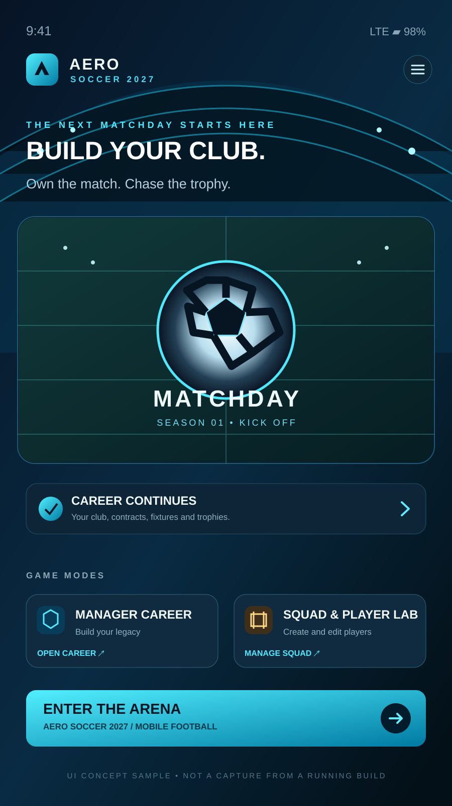
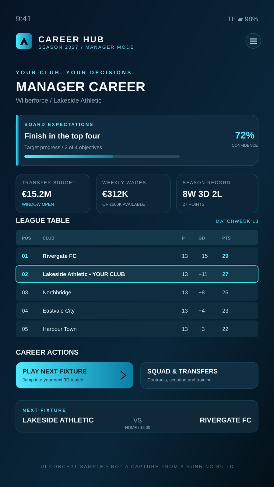
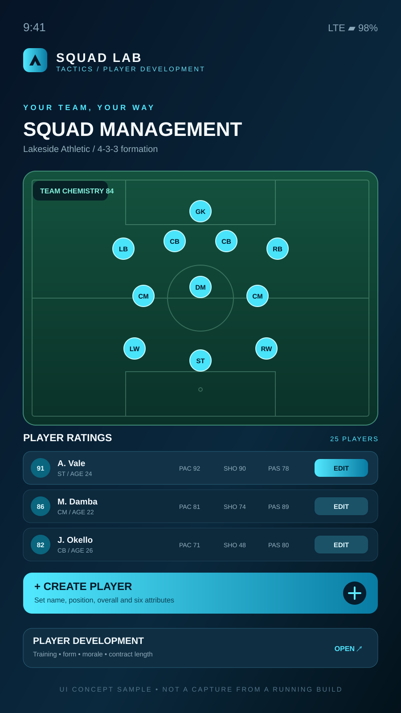
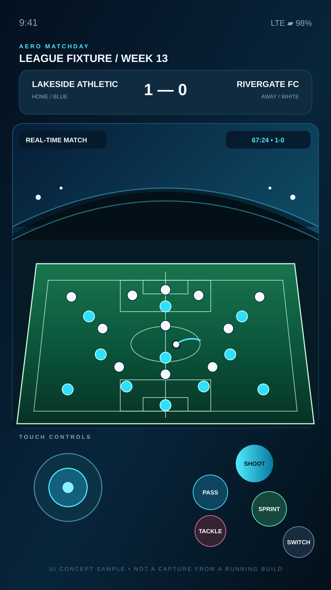

# AERO Soccer 2027 — Unity 6

The current Unity implementation of **AERO Soccer 2027** is an Android-first football-game prototype. It combines a Football World catalog, career/squad foundation, runtime 3D match arena, and mobile controls.

> **Prototype status:** recent career and presentation work is committed on a feature branch and still needs Editor compilation, EditMode execution, and device playtesting. This is not yet a release-ready game or an FC 26/Dream League Soccer visual equivalent. Screens below are documentation concept samples—not real Unity captures.

## Intended mobile screens

<table>
  <tr>
    <td align="center"><br><strong>Home hub</strong></td>
    <td align="center"><br><strong>Career hub</strong></td>
  </tr>
  <tr>
    <td align="center"><br><strong>Squad / Player Lab</strong></td>
    <td align="center"><br><strong>Matchday</strong></td>
  </tr>
</table>

## Requirements and setup

- Unity **6000.0.1f1** (the editor version recorded in `ProjectSettings/ProjectVersion.txt`).
- Android Build Support installed through Unity Hub, including Android SDK & NDK Tools and OpenJDK.
- Python 3.11 or a compatible Python 3 release to run the standard-library catalog validator.

### Open the project

1. Open this folder (`unity_app/`) in Unity Hub.
2. Allow Unity to resolve `Packages/manifest.json` and finish importing assets.
3. The `FootballWorldResourcesSync` editor utility copies canonical JSON files from `Assets/Data/FootballWorld/` to `Assets/Resources/FootballWorld/` when the Editor domain initializes. Confirm the Console reports the sync and successful catalog loading.
4. Open the intended boot scene, make sure it is listed in **File → Build Profiles → Scene List**, and enter Play Mode.
5. Confirm the catalog reports no errors. If no league or clubs are available, check the Resources sync and JSON validator before starting a career.

The catalog source of truth is `Assets/Data/FootballWorld/`. The runtime loader expects TextAssets at `Resources/FootballWorld/{players,clubs,leagues,competitions}.json`; do not edit generated Resources copies by hand.

## Career mode architecture

### Persistent save and state coordination

- `CareerModeManager`: versioned career document, save/load, migration, rolling backup, objectives, budget, contract, match-history and transfer records.
- `CareerRuntimeSnapshot`: saved calendar fixtures, league standings, player ratings in the active squad, starting eleven order, formation, player-progression records, scouting assignments/reports and active league club IDs.
- `CareerModeCoordinator`: joins the save profile to the calendar, live match manager, squad, transfer negotiations, scouting and player-progression systems.
- `CareerModeControlScreen`: runtime manager screen for new/resumed career, next fixture, training, advancing a week, objectives, contracts, sales and scouting.
- `SeasonCalendarManager`: double round-robin fixtures, league table calculations, fixture result recording and snapshot restoration.
- `CareerMatchSimulationEngine`: simulates unplayed AI fixtures in the current matchweek while the managed club's fixture is played in the 3D arena.

The save is stored under Unity's `Application.persistentDataPath` as `aero-career-save.json`, with a `.bak` recovery copy. The save manager also saves on application pause/quit. Test these behaviours on an actual Android device; lifecycle callbacks and storage characteristics still require device verification.

### Current season rules and known limits

Career code includes transfer-window checks, fee and weekly-wage budgets, 1–7 year contract records, contract aging/expiry, board-confidence movement at season end, league-position objectives, simplified cup-bracket progression and next-season fixture generation.

There are two data limitations to be aware of:

1. **Promotion/relegation requires multi-tier data.** The current bundled catalog contains 25 top-tier league identities, one per country, with 12 clubs each. The transition logic activates only when a suitable upper/lower tier exists in the same country. Add valid lower-division league and club records before expecting true promotion/relegation seasons.
2. **Cup support is simplified.** The bundled competition list contains league competitions and a cross-league cup definition. The code can build and advance simplified cup brackets, but domestic cup datasets, aggregate two-leg ties, extra time, penalty shoot-outs and full competition-specific qualification rules still need implementation.

The current player catalog has 7,500 generated fictional player profiles. Club identities are real-world entities, but player names and ratings are not verified current squads; several stadium names are generic placeholders. Do not market these data as official current rosters.

## Player Lab and squad state

`PlayerManagementScreen` is linked from Squad Management. It supports creating and editing player names, positions, overall ratings and six attributes. Custom-player persistence is club-scoped in `Application.persistentDataPath/custom-players.json`; career snapshots additionally store squad ratings, formation and starting-eleven order.

Transfer-market purchases and negotiated signings route through career budget/window/contract checks. Player sales also require an open window and retain at least eleven squad members. Scouting costs are charged against the same career transfer budget shown in the career profile.

## Runtime 3D match prototype

### Match arena and presentation

- `MatchArenaBootstrap` creates a pitch, ball, camera, teams and touch input at runtime.
- `AEROPitchPresentation` adds pitch markings, penalty areas, goal frames/net lattice, four stand sections, floodlights and directional lighting.
- `AEROGoalTrigger` registers physical ball crossings against the home/away match score.
- `BallController` uses Rigidbody dynamics, a tuned PhysicMaterial, rolling resistance, kick speed limits and spin.
- `MatchManager` manages match clock, score, half-time pause, resume and full-time events.

### Player rendering and animation

`AEROProceduralFootballerVisual` creates a basic articulated fallback body using torso, shorts, arms, legs, head, socks/boots and a procedural gait animation. `MatchArenaBootstrap` can load an optional rigged visual prefab from `Assets/Resources/AERO/FootballerVisual.prefab`, if supplied; `FootballerController` reads common Animator parameters from its child rig.

The fallback is **not a full skinned humanoid rig**. Authored animation clips, motion capture, keeper dives, tackles, celebrations, crowd simulations, high-fidelity kits/materials and detailed stadium assets remain unfinished.

### Android controls and quality profile

`AEROMatchTouchHud` builds a runtime screen-overlay HUD with a joystick and buttons for shoot, pass, sprint, tackle and switching the controlled player. `AEROAndroidQualityBootstrap` selects provisional 30/60 FPS, LOD, shadow, anti-aliasing and skin-weight settings based on reported device resources.

These are conservative defaults, not benchmark results. Measure real frame time, draw calls, memory, shader compilation, heat and battery use on a representative low-, mid- and high-tier Android device before treating them as final.

## World database and validation

Canonical JSON data resides in `Assets/Data/FootballWorld/`:

| File | Contains |
| --- | --- |
| `leagues.json` | 25 league identities |
| `clubs.json` | 300 club identities |
| `players.json` | 7,500 generated sample players |
| `competitions.json` | 26 competition definitions |

Runtime classes:
- `FootballWorldCatalogParser` — parses the JSON TextAssets.
- `FootballWorldCatalogLoader` — loads TextAssets from Resources and validates the database.
- `FootballWorldDatabase` — indexed lookup and cross-reference validation.
- `FootballWorldTeamFactory` — maps club/player catalog rows to `TeamData` and `PlayerData`.
- `FootballWorldRuntimeBootstrap` — ensures a loader is available before scenes start.

Run the Python validator from the repository root:

```bash
python unity_app/Tools/validate_football_world.py
```

It checks expected record counts, unique IDs, required display names, club-to-league and player-to-club references, competition league references, ratings and declared club counts.

## Unity EditMode tests and CI

Open **Window → General → Test Runner → EditMode** and run the tests beneath `Assets/Tests/Editor/`. Tests cover:

- world catalog load and reference integrity;
- double round-robin fixture generation and matchweek uniqueness;
- league points/goal difference and cup isolation from league standings;
- snapshot restore, career save/reload, wage budget, contract term and transfer-window rules.

The workflow at [AERO Career Validation](https://github.com/Wilberforcedev/FC2026-MOD-Apk/actions/workflows/aero-career-validation.yml) always runs Python/data-source checks. Unity EditMode tests and an Android APK build only execute when a Unity license is available through the repository's `UNITY_LICENSE` Actions secret. A skipped Unity job is **not** a passing Unity test.

### Build APK locally

1. Select **File → Build Profiles → Android**.
2. Switch to Android and check the boot scene in the Scene List.
3. Configure package identifier, orientation, minimum Android API and architecture for the supported device range.
4. Choose **Development Build** for early profiling.
5. Build an APK, install it with ADB or on a test device, and check startup/catalog logs, save/load across force-close, match scoring, UI scaling and frame pacing.

Signing, keystore storage, store metadata and release builds are separate release tasks.

## Unity Gaming Services multiplayer

The project also contains an experimental Unity Gaming Services Authentication + Lobby + Relay path with Netcode for GameObjects. It requires a Unity Dashboard project, enabled Authentication/Lobby/Relay services, scene NetworkManager/UnityTransport setup and a registered network player prefab. Anonymous auth is appropriate for a prototype only; production accounts should link to a durable identity provider before storing purchases or rankings. Multiplayer service orchestration has not been validated as part of the career-mode work.

## Useful project paths

| Path | Role |
| --- | --- |
| `Assets/Data/FootballWorld/` | Canonical catalog JSON |
| `Assets/Resources/FootballWorld/` | Editor-synced runtime JSON TextAssets |
| `Assets/Scripts/CareerModeManager.cs` | Career document/persistence |
| `Assets/Scripts/CareerModeCoordinator.cs` | System integration |
| `Assets/Scripts/SeasonCalendarManager.cs` | Fixtures and standings |
| `Assets/Scripts/CareerModeControlScreen.cs` | Manager-career UI |
| `Assets/Scripts/PlayerManagementScreen.cs` | Create/edit Player Lab |
| `Assets/Scripts/MatchArenaBootstrap.cs` | Runtime match scene |
| `Assets/Scripts/AEROProceduralFootballerVisual.cs` | Procedural footballer fallback |
| `Assets/Scripts/AEROMatchTouchHud.cs` | Android match controls |
| `Assets/Tests/Editor/` | EditMode tests |
| `Tools/validate_football_world.py` | Catalog validator |

